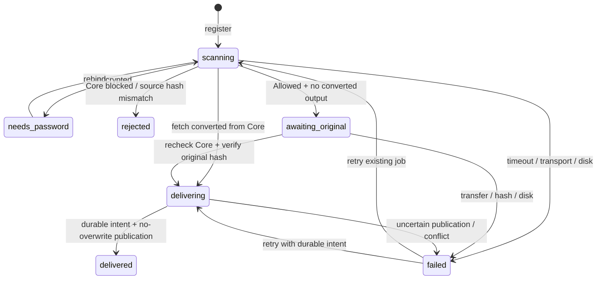

# receiver HTTP API

所有操作使用 `Authorization: Bearer <MD_RECEIVER_TOKEN>`。`POST /webhook` 使用**獨立**的 `MD_WEBHOOK_TOKEN`。正式遠端監聽需 TLS；只允許 loopback 開發環境使用明文監聽。沒有舊 C client 的 `/sanitized`／`/submit-original` 相容介面。

| 路徑 | 方法 | 用途 |
| --- | --- | --- |
| `/destinations` | GET | `[{"key":"production","label":"正式分享目錄"}]`；不揭露實體路徑，不驗證寫入權限 |
| `/jobs` | POST | 登記 UUID、批次 UUID、Core ID、目的地代號、檔名及 SHA-256 |
| `/jobs/{id}` | GET | 查詢狀態與已發布檔名 |
| `/jobs/{id}/original` | POST | 串流原檔，僅 `awaiting_original` 可用；重查 Core，驗證雜湊後發布 |
| `/jobs/{id}/rebind` | POST | 等待密碼的工作換用新掃描 Core ID；原 UUID／目的地／檔名／SHA 不變 |
| `/jobs/{id}/retry` | POST | 恢復既有失敗工作；有投遞意圖則先核對正式檔案，不建立新工作 |
| `/webhook` | POST | `{"id":"UUID"}` 通知；202 表示接受通知，並非送達 |

登記範例：

```json
{
  "id": "ce2fb41f-8016-4bca-b3ed-adb2660c5fd8",
  "batch_id": "b9d5f7f5-f6ed-4fe1-9a3f-3916a9634231",
  "data_id": "5e1c058802c54777b39f00afea53fcc2",
  "destination": "production",
  "filename": "中文報告.txt",
  "sha256": "0123456789abcdef0123456789abcdef0123456789abcdef0123456789abcdef"
}
```

相同 UUID 與完全相同內容重複登記，回傳同一工作；不同內容或重用 Core ID 回覆 409。密碼重掃後舊 Core ID 綁定仍保留，避免舊通知另建投遞。檔名限制原名 UTF-8 200 bytes，保留 Unicode，排除路徑、Windows 保留字與禁止字元；發布名含 UUID 後綴，最多 240 bytes。目的地只能使用設定中的代號。

換綁範例：

```json
{
  "previous_data_id": "5e1c058802c54777b39f00afea53fcc2",
  "data_id": "a01c058802c54777b39f00afea53fcc3"
}
```

回覆 `JobStatus` 包含 `registration`、`state`、`content`、`failure`、`delivered_name`、`updated_at`。`content` 為 `sanitized`／`original` 或 null；不可解析顯示文字來判斷原檔。`failure` 包含 `step`、`message`、`http_status` 與 `retry_safe`，不包含上游本文、請求標頭、密碼或金鑰。

`retry_safe = false` 表示結果需核對，不允許重新建立掃描／登記來碰運氣。`/retry` 仍可恢復**同一個 UUID**，核對既有投遞意圖；正式內容不同或無法判定時，維持失敗且不覆寫。



`/webhook` 只接受小型 JSON 通知，忽略其他欄位，不接收正式檔案。worker 每兩秒主動輪詢已登記工作，因此 Core 不需要向 receiver 傳送帶檔案內容的 webhook，也不需要獲得 client 的 bearer token。Core 原生 callback JSON 並非這個通知格式；若要轉接，應由受信任代理送 UUID 通知。即使不設定任何 webhook，工作仍會完成。

掃描要求 `process_info` 與 `scan_results` 的進度皆為 100，並有 Allowed／Blocked 最終判定。12／15 號結果需密碼。缺少 Core SHA-256 或與登記不符則拒絕。Allowed 後從 `/file/converted/{data_id}` 取檔；只有 404 且 Core 沒有清洗輸出證據才要求原檔。有清洗證據但留存檔已被移除、Core 非 404 錯誤或清洗雜湊不符，均失敗，不降級投遞原檔。
