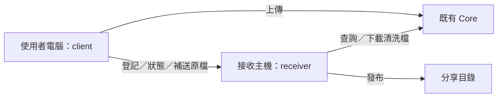

# 開始使用與部署

目前提供 **macOS Apple Silicon（ARM64）可攜式套件**，含桌面用戶端與接收服務。執行套件不需要 Cargo，也不需要重新編譯。

## 先開啟畫面

1. 在 Finder 開啟整個 `metadefender-0.1.0-aarch64-apple-darwin` 資料夾。
2. 雙擊 **`MetaDefender.app`**，或 **`開啟用戶端.command`**。
3. 未設定 Core／receiver 時，畫面會顯示設定或連線提示，傳送按鈕停用；可以先查看三個分頁與檔案清單。

這台 Mac 的套件位置：

```text
/Users/cunyuan/Documents/project/test_opswat_client/dist/metadefender-0.1.0-aarch64-apple-darwin/
```

也可從終端機開啟：

```sh
cd /Users/cunyuan/Documents/project/test_opswat_client/dist/metadefender-0.1.0-aarch64-apple-darwin
./start-client.sh
```

保留整個套件資料夾。這個可攜式版本的 `config` 與工作紀錄在 `.app` 旁邊，請勿單獨搬走 `.app`。

## 正式部署的位置

| 元件 | 放置位置 | 用途 |
| --- | --- | --- |
| `MetaDefender.app`／`bin/client` | 使用者電腦 | 選檔、上傳、查看結果 |
| `bin/receiver` | 能連 Core、能寫正式目錄的接收主機 | 驗證結果、下載清洗檔、投遞 |
| MetaDefender Core | 既有 Core 主機 | 提供掃描／清洗；本套件不含 Core |
| 分享目錄 | 既有 SMB／NAS 或已掛載目錄 | 保存接收服務確認可投遞的檔案 |



client 與 receiver 可以先放在同一台 Mac。Windows／Linux 接收主機需要對應平台的 binary，須先在該平台建置或執行 CI；目前的 macOS 套件不能在 Windows／Linux 執行。

## 準備實際設定

需要 Core URL／API key、receiver URL／TLS chain／私鑰、正式目錄路徑與存取權。另準備兩組不同的隨機 token，各至少 32 bytes：receiver token 由 client／receiver 共用，webhook token 只給 receiver。請用密碼管理工具產生與保管，憑證值不必貼到聊天。

| 連線 | 範例 port | 設定位置 |
| --- | --- | --- |
| client／receiver → Core | `8008`，以 Core 實際設定為準 | 兩份設定的 `[core].url` |
| client → receiver | `8443` | receiver 的 `listen`、client 的 `[receiver].url` |
| receiver → SMB | 通常 `445` | 作業系統掛載／UNC |

先前測試的 `127.0.0.1:0` 是隨機測試埠，**不用填進部署設定**。

## 第一步：接收主機啟動 receiver

先掛載分享目錄，再於套件目錄首次建立設定：

```sh
cp config/receiver.example.toml config/receiver.toml
mkdir -p state certificates
```

已有自己的 `receiver.toml` 時，直接編輯，不重新複製。填入：

| 欄位 | 內容 |
| --- | --- |
| `listen` | 例如 `0.0.0.0:8443` |
| `[core].url` | 實際 Core URL |
| `[tls].certificate_pem` | TLS chain 檔案位置 |
| `[tls].private_key_pem` | TLS 私鑰檔案位置 |
| `[destinations.production].label` | 顯示給使用者的目的地名稱 |
| `[destinations.production].path` | 已掛載目錄，例如 `/Volumes/TransferShare/Incoming` |

將 TLS 檔案放到設定位置。Core 若用組織 CA，設定 `[core].ca_pem`。非本機監聽需 TLS；Core 若實際使用 HTTP，該 `[core].allow_insecure_http` 需明確設為 `true`。

在 macOS zsh 終端機輸入憑證並啟動。以下會隱藏輸入，實際值不會寫入指令歷史：

```zsh
read -r -s 'MD_CORE_API_KEY?Core API key：'
printf '\n'
export MD_CORE_API_KEY
read -r -s 'MD_RECEIVER_TOKEN?Receiver token：'
printf '\n'
export MD_RECEIVER_TOKEN
read -r -s 'MD_WEBHOOK_TOKEN?Webhook token：'
printf '\n'
export MD_WEBHOOK_TOKEN
./start-receiver.sh
```

保留終端機；Ctrl+C 停止服務。這裡以前景程序執行，尚未安裝為開機自啟服務。正式常駐可由目標主機的服務管理器提供相同環境變數與工作目錄。

## 第二步：使用者電腦啟動 client

於套件目錄首次建立設定：

```sh
cp config/client.example.toml config/client.toml
```

編輯 `config/client.toml`：

| 欄位 | 內容 |
| --- | --- |
| `[core].url` | 同一個實際 Core URL |
| `[receiver].url` | 可連到的 receiver URL，例如 `https://receiver.company.example:8443` |
| `[core].ca_pem` | Core 組織 CA，公開信任憑證可不填 |
| `[receiver].ca_pem` | receiver 組織 CA，公開信任憑證可不填 |

在這台電腦的 macOS zsh 終端機輸入憑證並啟動：

```zsh
read -r -s 'MD_CORE_API_KEY?Core API key：'
printf '\n'
export MD_CORE_API_KEY
read -r -s 'MD_RECEIVER_TOKEN?Receiver token（與接收服務相同）：'
printf '\n'
export MD_RECEIVER_TOKEN
./start-client.sh
```

從此終端機啟動，GUI 才能繼承剛才的憑證。Finder 雙擊可以先看畫面；它不會自動讀取另一個終端機剛 export 的值。

## 第三步：試傳與驗收

1. 「連線設定」確認 URL，等待 Core 與 receiver 綠燈；失敗時檢查設定、憑證、網路與 token，再按「重試」。
2. 「檔案傳送」手動選擇掃描規則與目的地。
3. 用測試檔試傳，確認已送達，並在分享目錄找到帶 UUID 後綴的檔案。
4. 依 `docs/VERIFICATION.md` 完成真實 Core、SMB、重啟與 GUI 驗收，再安排正式使用。

完整儲存、TLS 與復原規則見 `docs/OPERATIONS.md`。目前僅 macOS 原生編譯與部分測試通過，真實 Core／SMB 部署仍待驗收。
